  

  
  
  
  
  
  

---

# 🚀 Awesome Service Portal

> **A curated directory of premier Enterprise SaaS platforms and self-hosted Open-Source GitHub projects for modern Service Portals, Employee Self-Service hubs, and IT Help Desk ecosystems.**

Service portals serve as the central **digital front door** for organizations, unifying IT help desks, HR service requests, facility operations, and automated knowledge resolution. Whether orchestrating complex ITIL enterprise workflows or deploying sovereign, self-hosted ticketing infrastructure without per-agent seat tax, this guide catalogs the finest solutions available today.

---

## 📑 Table of Contents

- [🌐 Sector Overview & Market Dynamics](#-sector-overview--market-dynamics)
- [🏢 Top SaaS Service Portals (Ranked by Scale)](#-top-saas-service-portals)
- [💻 Open-Source GitHub Projects (Ranked by Stars)](#-open-source-github-projects)
- [🎯 Key Evaluation Criteria for Service Portals](#-key-evaluation-criteria-for-service-portals)
- [🤝 How to Contribute](#-how-to-contribute)
- [⭐ Star History](#-star-history)
- [💖 Support](#-support)
- [⚖️ Disclaimer](#-disclaimer)

---

## 🌐 Sector Overview & Market Dynamics

The global **IT Service Management (ITSM) and Enterprise Service Management (ESM) Portal** market was valued at **$10.5 billion to $11.8 billion** in 2024 and is projected to surpass **$25.0 billion by 2030**, expanding at a compound annual growth rate (**CAGR**) of **~16.2%**. Rapid growth is propelled by enterprise digital transformation, automated ticket deflection powered by generative and agentic AI, and the expansion of service portal concepts into business units outside IT (including People Ops/HR, Legal, Finance, and Facilities).

The market structure is **moderately concentrated at the top and highly fragmented across mid-market and self-hosted tiers**:
- **Enterprise Concentration:** The mega-enterprise tier operates with high barriers to entry, where category titans—most notably **ServiceNow** (holding >40% enterprise ITSM market share), **Atlassian**, and **BMC Software**—capture multi-million-dollar annual contracts through deeply integrated platform ecosystems.
- **Mid-Market & Open-Source Fragmentation:** Below the mega-cap tier, the market is highly competitive and fragmented. Cloud challengers like **Freshservice**, **ManageEngine**, **SolarWinds**, **TOPdesk**, and **HaloITSM** contest aggressively on time-to-value and licensing flexibility. Concurrently, data sovereignty mandates, compliance requirements (GDPR/HIPAA), and resistance to steep per-technician licensing fees have fueled surging adoption of sovereign **open-source solutions** (such as Chatwoot, UVdesk, GLPI, and Zammad).

---

## 🏢 Top SaaS Service Portals

*The table below compares leading commercial SaaS service portal solutions, ranked in descending order by parent company scale (market capitalization or valuation).*

| 🏢 Platform / Portal | 📈 Company Scale (Valuation / Revenue) | ⚙️ Architecture & Key Strengths | 💳 Starting Tier Pricing | 🎁 Free Tier / Free Trial Limits |
| :--- | :--- | :--- | :--- | :--- |
| **[ServiceNow Service Portal](https://www.servicenow.com/)** | **~$190 Billion** Market Cap *(~$10.0B ARR)* | Enterprise-grade modular portal framework built on AngularJS & Bootstrap; visual Widget Editor, theme-driven branding, CMDB binding, and deep Now Platform workflow orchestration. | **~$70 – $100** / fulfiller agent / month *(annual contract; custom enterprise quote)* | **No production free tier** *(Requesters browse for free; Personal Developer Instance [PDI] available indefinitely for non-commercial sandbox testing)* |
| **[Jira Service Management](https://www.atlassian.com/software/jira/service-management)** *(Atlassian)* | **~$48 Billion** Market Cap *(~$4.4B ARR)* | Deep Jira ecosystem synergy, Confluence-backed knowledge base deflection, customizable request queues, low-code approval forms, and automated portal transitions. | **$20.00** / agent / month *(or $17.65/agent/mo billed annually on Standard)* | **Free forever plan** for up to **3 agents**, unlimited portal customer requesters, 2 GB file storage, and community support |
| **[ManageEngine ServiceDesk Plus](https://www.manageengine.com/products/service-desk/)** *(Zoho Corp)* | **~$18 Billion** Valuation *(~$1.2B+ ARR)* | Drag-and-drop self-service portal designer, dynamic HTML/Deluge widgets, multi-department service catalogs, built-in ITAM, and native mobile requester apps. | **$13.00** / technician / month *(Standard Cloud; or $10/tech/mo billed annually)* | **Free forever edition** for up to **5 technicians**, unlimited requesters, incident tracking, self-service portal, and knowledge base |
| **[BMC Helix Digital Workplace](https://www.bmc.com/it-solutions/bmc-helix-digital-workplace.html)** *(BMC Software)* | **~$9 Billion** Valuation *(~$2.0B ARR; KKR)* | Enterprise omnichannel self-service console unifying IT and HR catalogs, AI virtual assistants, facility room reservations, and ITIL v4 compliance. | **~$110 – $180** / agent / month base ITSM *(Digital Workplace portal add-on ~$25 – $60/user/mo in 100-user blocks)* | **No public free tier** *(30-day sales-assisted guided Proof-of-Concept [PoC] sandbox environment for qualifying enterprise teams)* |
| **[Cherwell Self-Service Portal](https://www.cherwell.com/)** *(Ivanti)* | **~$4 Billion** Valuation *(~$1.0B+ ARR; PE-backed)* | Codeless portal and form configuration, drag-and-drop service catalog layouts, automated approval loops, and migration pathway to Ivanti Neurons for ITSM. | **~$25 – $59** / analyst / month *(Ivanti Neurons for ITSM entry baseline; annual commitment)* | **No permanent free tier** *(14-day guided proof-of-concept sandbox evaluation available through sales scheduling)* |
| **[Freshservice](https://www.freshworks.com/freshservice/)** *(Freshworks)* | **~$3.8 Billion** Market Cap *(~$720M ARR)* | Modern consumer-grade portal UI, Shopify-like service catalog checkout, Freddy AI conversational deflection, dynamic intake forms, and employee onboarding modules. | **$19.00** / agent / month *(Starter tier billed annually; or $29/agent/mo billed monthly)* | **14-day free trial** with full access to Starter/Growth tier features, unlimited requesters, and zero credit card required |
| **[SolarWinds Service Desk](https://www.solarwinds.com/service-desk)** *(SolarWinds)* | **~$2.1 Billion** Market Cap *(~$760M ARR)* | Integrated IT service portal with automated ticket routing, knowledge search deflection, service catalog, and deep integration with SolarWinds observability and asset monitoring. | **$39.00** / technician / month *(Essentials plan billed annually)* | **30-day free trial** featuring unrestricted Premier-level capabilities, unlimited requesters/technicians, and zero credit card required |
| **[TOPdesk](https://www.topdesk.com/)** *(TOPdesk)* | **~$900 Million** Valuation *(~$190M ARR; CVC Growth)* | Unified Shared Service portal connecting IT, facilities, and HR; intuitive knowledge base search, modular request forms, and rapid time-to-value deployment. | **~$79.00** *(€65.00)* / agent / month *(Essential tier billed annually)* | **30-day free trial** with full access to operator and end-user self-service portal workflows; no credit card required |
| **[HaloITSM](https://www.haloitsm.com/)** *(Halo Service Solutions)* | **~$280 Million** Valuation *(~$45M ARR)* | All-inclusive ITSM suite without feature paywalls; modern self-service portal with end-to-end ITIL processes, SLA timers, and multi-tenant catalog capabilities. | **$99.00** / agent / month *(billed annually for 3–10 agents; scales lower with volume)* | **30-day free trial** providing 100% full platform features, unlimited requesters, and zero credit card required |
| **[SysAid Portal](https://www.sysaid.com/)** *(SysAid Technologies)* | **~$180 Million** Valuation *(~$20M ARR; IGP-backed)* | AI-first service desk with embedded SysAid Copilot for zero-touch ticket resolution, asset discovery integration, customizable self-service portal, and BI reporting. | **$89.00** / agent / month *(Professional plan starting tier)* | **30-day free trial** with complete access to agentic AI copilot, ticketing workflows, and user portal; no credit card required |

---

## 💻 Open-Source GitHub Projects

*The following open-source projects provide complete data sovereignty, custom self-service portal extensibility, and zero per-seat licensing fees. Repositories are ranked in descending order by GitHub stargazer count.*

### 1. **[Chatwoot](https://github.com/chatwoot/chatwoot)** 
- 🏷️ **Tech Stack:** Ruby on Rails, Vue.js, PostgreSQL, Redis
- 📜 **License:** AGPL-3.0
- 💡 **Overview:** An open-source, omnichannel customer engagement and helpdesk suite. Features a customer self-service Help Center portal, live chat widget, email piping, and automated bot integrations for rapid ticket deflection.

### 2. **[UVdesk Community](https://github.com/uvdesk/community-skeleton)** 
- 🏷️ **Tech Stack:** PHP (Symfony framework), MySQL
- 📜 **License:** MIT
- 💡 **Overview:** A modular, full-featured enterprise helpdesk portal. Delivers an extensive customer ticketing portal, customizable knowledge base, SLA management, automated dispatch workflows, and an extensible bundle architecture.

### 3. **[GLPI](https://github.com/glpi-project/glpi)** 
- 🏷️ **Tech Stack:** PHP, MariaDB/MySQL, JavaScript
- 📜 **License:** GPL-3.0
- 💡 **Overview:** Comprehensive open-source IT asset management (ITAM) and service desk application. Offers ITIL-aligned service catalogs, a customizable requester self-service portal, project management, financial tracking, and SLA enforcement.

### 4. **[Zammad](https://github.com/zammad/zammad)** 
- 🏷️ **Tech Stack:** Ruby on Rails, WebSocket, PostgreSQL, Elasticsearch
- 📜 **License:** AGPL-3.0
- 💡 **Overview:** Modern web-based helpdesk and issue-tracking system. Features a sleek, responsive customer portal where users submit and track tickets, search integrated knowledge bases, and interact via multi-channel communications (email, chat, telephone, SMS).

### 5. **[FreeScout](https://github.com/freescout-help-desk/freescout)** 
- 🏷️ **Tech Stack:** PHP (Laravel framework), MySQL
- 📜 **License:** AGPL-3.0
- 💡 **Overview:** Lightweight, self-hosted alternative to Zendesk and Help Scout. Provides an intuitive customer portal, shared inbox management, multi-lingual knowledge base, LDAP/SAML authentication, and mobile-ready interface.

### 6. **[osTicket](https://github.com/osTicket/osTicket)** 
- 🏷️ **Tech Stack:** PHP, MySQL
- 📜 **License:** GPL-2.0
- 💡 **Overview:** Proven, widely deployed open-source support ticket platform. Features a dedicated customer service portal for ticket tracking and creation, customizable form fields, auto-responders, internal notes, and role-based access control.

### 7. **[Frappe Helpdesk](https://github.com/frappe/helpdesk)** 
- 🏷️ **Tech Stack:** Python (Frappe Framework), Vue 3, MariaDB/PostgreSQL
- 📜 **License:** GPL-3.0
- 💡 **Overview:** Modern, streamlined customer service and internal support platform. Includes dual dedicated portals for agents and requesters, SLA tracking, automated routing rules, integrated knowledge base search, and Docker-first deployment.

### 8. **[Peppermint](https://github.com/Peppermint-Lab/peppermint)** 
- 🏷️ **Tech Stack:** Node.js, Next.js, React, MongoDB
- 📜 **License:** GPL-3.0
- 💡 **Overview:** Lightweight, modern open-source ticket management and help desk system. Offers a clean client portal interface, markdown documentation integration, email piping, and straightforward Docker Compose orchestration.

### 9. **[Helpy](https://github.com/helpyio/helpy)** 
- 🏷️ **Tech Stack:** Ruby on Rails, PostgreSQL
- 📜 **License:** MIT
- 💡 **Overview:** Mobile-first, multi-channel help desk application. Features an integrated customer self-service knowledge base, community support forums, ticketing portal, and multi-language localization.

### 10. **[Trudesk](https://github.com/polonel/trudesk)** 
- 🏷️ **Tech Stack:** Node.js, MongoDB, Elasticsearch
- 📜 **License:** Apache-2.0
- 💡 **Overview:** Real-time open-source help desk and ticketing software. Equipped with a responsive end-user portal, real-time ticket updates via WebSockets, SLA management, and customizable service catalogs.

### 11. **[Faveo Helpdesk](https://github.com/faveosuite/faveo-helpdesk)** 
- 🏷️ **Tech Stack:** PHP (Laravel framework), MySQL
- 📜 **License:** OSL-3.0
- 💡 **Overview:** Enterprise-ready ticketing and helpdesk application. Supplies a customizable self-service portal with FAQ integration, multi-channel ticket logging, SLA rules, and dynamic request form fields.

### 12. **[Request Tracker (RT)](https://github.com/bestpractical/rt)** 
- 🏷️ **Tech Stack:** Perl, PostgreSQL/MySQL
- 📜 **License:** GPL-2.0
- 💡 **Overview:** Industrial-strength, high-volume issue tracking and service management platform. Deployed by universities, government entities, and enterprises globally for customer service, incident response, and custom workflow tracking.

### 13. **[Znuny](https://github.com/znuny/Znuny)** 
- 🏷️ **Tech Stack:** Perl, JavaScript, MariaDB/PostgreSQL
- 📜 **License:** GPL-3.0
- 💡 **Overview:** Active open-source continuation of the classic OTRS ITSM platform. Provides an enterprise customer self-service portal, ITIL service catalogs, CMDB integrations, ticket merging/splitting, and automated escalation workflows.

### 14. **[FreeITSM](https://github.com/edmozley/freeitsm)** 
- 🏷️ **Tech Stack:** Python, Django, SQLite/PostgreSQL
- 📜 **License:** AGPL-3.0
- 💡 **Overview:** Privacy-centric, lightweight ITSM tool. Features multi-tenancy for Managed Service Providers (MSPs), Active Directory employee sync, webhook notifications (Slack/Teams/Discord), and historical uptime status tracking.

---

## 🎯 Key Evaluation Criteria for Service Portals

When choosing between commercial SaaS platforms and self-hosted open-source stacks, evaluate against these five critical dimensions:

1. **Ticket Deflection & Knowledge Search 🔍:** Does the portal automatically suggest relevant solutions as users type their request? AI-assisted deflection can eliminate 30–50% of routine Tier-1 inquiries.
2. **Service Catalog Flexibility 🛍️:** Can administrators configure dynamic, conditional forms for complex hardware/software provisioning and multi-stage managerial approvals without writing bespoke code?
3. **Directory & Identity Integration 🔐:** Does the portal support single sign-on (SSO) via SAML 2.0, OpenID Connect, Azure AD / Entra ID, or Okta with role-based access control (RBAC)?
4. **ITIL & ESM Alignment 📋:** Does the platform natively handle ITIL practices (Incident, Problem, Change, Release, and Asset Management) while scaling across non-IT departments like HR and Facilities?
5. **Data Sovereignty & Licensing TCO 💰:** Assess the total cost of ownership: per-agent SaaS licenses vs. the self-hosted operational cost of sovereign deployments (GLPI, Zammad, Frappe Helpdesk).

---

## 🤝 How to Contribute

Contributions, updates, and corrections are warmly welcomed! 🌟

1. **Fork the repository** to your GitHub account.
2. **Create a branch** for your updates (`git checkout -b add/new-service-portal`).
3. **Add or edit entries** following the established format:
   - Provide verified product/project name and official URL.
   - Include factual specifications: tech stack, starting pricing, free tier/trial limits, and company scale or GitHub stargazer badge.
4. **Submit a Pull Request** with a concise description of your additions.

---

## ⭐ Star History

---

## 💖 Support

Thank you for exploring and utilizing **Awesome-Service-Portal**! 🎉

If you find this curated directory helpful for your team, organization, or research, please consider supporting the project:
- ⭐ **Star this repository** to help others discover it.
- 🍴 **Fork and contribute** your domain expertise.
- 📢 **Share with your colleagues** on LinkedIn, X/Twitter, or Reddit.
- ☕ **Sponsor or buy a coffee**: Back ongoing maintenance and curation on the [GitHub Sponsor Dashboard](https://github.com/sponsors/ishandutta2007).

  

---

## ⚖️ Disclaimer

- This repository is a **community-curated guide** intended for informational and educational purposes. Inclusion does not imply official endorsement.
- All product names, logos, and brands are property of their respective owners.
- Service portals handling sensitive employee, customer, or enterprise data must comply with applicable privacy regulations (**GDPR, CCPA, HIPAA, SOC 2**).
- Open-source solutions should always be deployed following security hardening best practices, automated backups, and TLS encryption.

---

  <b>Built with ❤️ for IT leaders, helpdesk administrators, sysadmins, and digital workplace engineers.</b>

